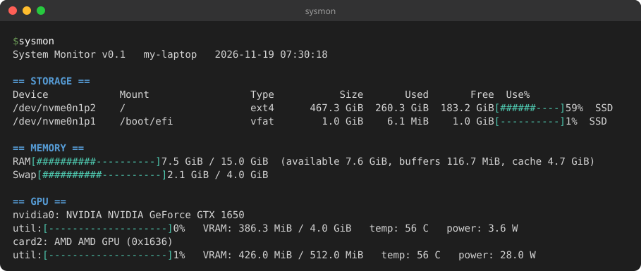
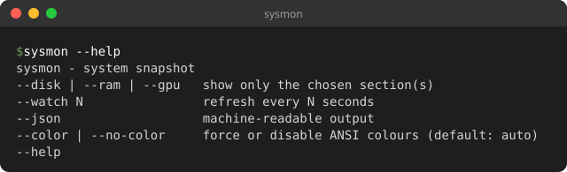
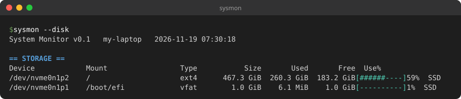
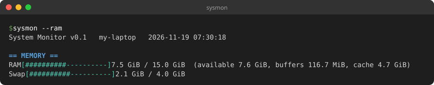
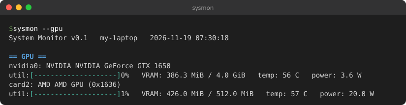
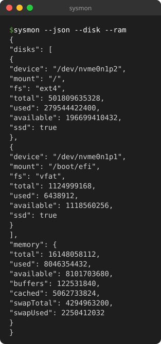

# sysmon — Linux System Monitor in C++20

A fast, dependency-free command-line tool that takes a **snapshot of your machine** and reports
**disk storage, RAM / swap and GPU usage** — for NVIDIA *and* AMD GPUs side by side.
Use it as a one-shot report, a live dashboard (`--watch`), or as JSON for scripts.



> Screenshots in this README are generated from the program's real output by
> [`docs/make_screenshots.py`](docs/make_screenshots.py). The hostname is replaced with `my-laptop`.

---

## Features

| Area | What you get |
|---|---|
| **Storage** | Every *real* mounted filesystem: device, mount point, type, size, used, free, `Use%` bar, SSD/HDD detection |
| **Memory** | RAM used / available / buffers / cache, plus swap — with colour-coded bars |
| **GPU** | Per GPU: utilisation %, VRAM used/total, temperature, power draw |
| **Hybrid graphics** | Handles NVIDIA (via NVML) **and** AMD (via sysfs) in the same report |
| **Output modes** | Coloured text, `--json`, live `--watch N` |
| **Robust** | Missing drivers or unreadable files show `N/A` instead of crashing |
| **Zero dependencies** | Only the C++ standard library, `/proc`, `/sys`, `statvfs` and `dlopen` |

Bars are green below 60 %, yellow below 85 % and red from 85 % upward. Colour is switched off
automatically when output is piped.

---

## Quick start

**Requirements:** Linux, a C++20 compiler (g++ ≥ 11 / clang ≥ 14) and CMake ≥ 3.20.

```bash
git clone <your-repo-url> sysmon && cd sysmon
cmake -B build -DCMAKE_BUILD_TYPE=Release
cmake --build build -j
./build/sysmon
```

---

## Usage

```text
sysmon [options]

  --disk | --ram | --gpu   show only the chosen section(s)
  --watch N                refresh every N seconds
  --json                   machine-readable output
  --color | --no-color     force or disable ANSI colours (default: auto)
  --help
```



Examples:

```bash
./build/sysmon                  # full snapshot
./build/sysmon --disk --ram     # two sections only
./build/sysmon --watch 2        # live dashboard, refresh every 2 s (Ctrl+C to quit)
./build/sysmon --json | jq .    # pipe into other tools
```

---

## Sections in detail

### Storage



- Reads `/proc/mounts`, then keeps only **real** filesystems (`ext4`, `btrfs`, `xfs`, `vfat`, `ntfs`, `exfat`, `nfs`, …).
  `loop`, `tmpfs`, `squashfs`, `overlay`, `proc`, `cgroup` and similar pseudo-mounts are ignored — no snap clutter.
- Sizes come from `statvfs()`. **Used** = `blocks − free blocks` and **Use%** = `used / (used + available)`,
  the same definitions `df` uses, so the numbers match `df -hT`.
- A device mounted in several places is listed once (first mount point).
- Octal escapes in `/proc/mounts` (`my\040usb`) are decoded back to real paths.
- **SSD / HDD** is read from `/sys/block/<disk>/queue/rotational`. Partition names are mapped to their parent
  disk (`nvme0n1p2 → nvme0n1`, `mmcblk0p1 → mmcblk0`, `sda1 → sda`).

### Memory



- Parsed from `/proc/meminfo`.
- **Used = `MemTotal − MemAvailable`**, *not* `MemTotal − MemFree`: Linux uses idle RAM as page cache, so
  `MemFree` makes a healthy system look nearly full. This matches the `used`/`available` logic of `free`.
- Swap is shown as a bar, or `Swap  none` when no swap is configured.

### GPU



| Vendor | Source |
|---|---|
| **NVIDIA** | **NVML**, loaded at runtime with `dlopen("libnvidia-ml.so.1")` — no `nvml.h` or SDK needed. Falls back to `nvidia-smi`, then to "driver not available". |
| **AMD** | sysfs: `gpu_busy_percent`, `mem_info_vram_used/total`, `hwmon/*/temp1_input`, `power1_average` |
| **Intel / other** | Listed with a "no reader for this vendor" note |

Cards are discovered from `/sys/class/drm/card*` and identified by PCI vendor id (`0x10de` NVIDIA,
`0x1002` AMD, `0x8086` Intel). Every metric is read independently: if one fails, only that field shows `N/A`.

> ⚠️ **Hybrid laptops:** querying a sleeping NVIDIA GPU can wake it and cost a little battery.

### JSON output



`--json` prints one compact JSON object (shown pretty-printed above). Sizes are in **bytes**; metrics a GPU
doesn't report are `null`. Sections follow the `--disk` / `--ram` / `--gpu` selection.

---

## How it works

```
        ┌────────────┐   plain structs    ┌─────────────┐
 /proc ─▶ collectors ├───────────────────▶   printers   ├─▶ text / JSON
 /sys  ─▶ (no I/O to │ DiskInfo           │ (main.cpp)  │
 NVML  ─▶  stdout)   │ MemoryInfo         └─────────────┘
        └────────────┘ GpuInfo
```

Collectors only return data; printing is separate. That keeps the parsers unit-testable with sample text and
makes new output formats cheap to add.

```
.
├── CMakeLists.txt
├── include/            types, utils, format, disk, memory, gpu headers
├── src/
│   ├── main.cpp        CLI parsing, text + JSON printers, --watch loop
│   ├── disk.cpp        /proc/mounts parsing, filtering, statvfs, SSD detection
│   ├── memory.cpp      /proc/meminfo parser
│   ├── gpu.cpp         card discovery + vendor dispatch
│   ├── gpu_amd.cpp     sysfs reader
│   ├── gpu_nvidia.cpp  NVML via dlopen (RAII) + nvidia-smi fallback
│   ├── format.cpp      byte formatting, progress bars
│   └── utils.cpp       file reading, trim, split
├── tests/test_parsers.cpp
└── docs/               README screenshot generator + images
```

---

## Testing

Parsers are tested against sample text, so tests don't depend on the machine they run on.

```bash
./build/test_parsers          # or: ctest --test-dir build
```

Sanitizer build:

```bash
cmake -B build-asan -DCMAKE_BUILD_TYPE=Debug -DCMAKE_CXX_FLAGS="-fsanitize=address,undefined"
cmake --build build-asan -j && ./build-asan/test_parsers && ./build-asan/sysmon
```

Cross-check against standard tools: `df -hT`, `free -b`, `nvidia-smi`, `lsblk`.

## Regenerating the screenshots

```bash
cmake --build build -j && python3 docs/make_screenshots.py
```

## Roadmap

- [ ] Disk I/O throughput from `/proc/diskstats`
- [ ] CPU usage from `/proc/stat`
- [ ] SMART / NVMe health
- [ ] Per-process GPU memory (`nvmlDeviceGetComputeRunningProcesses`)
- [ ] `--no-wake` flag for sleeping hybrid GPUs
- [ ] TUI (ncurses / FTXUI) and a Windows port

## License

Choose a license (for example MIT) and add a `LICENSE` file.
